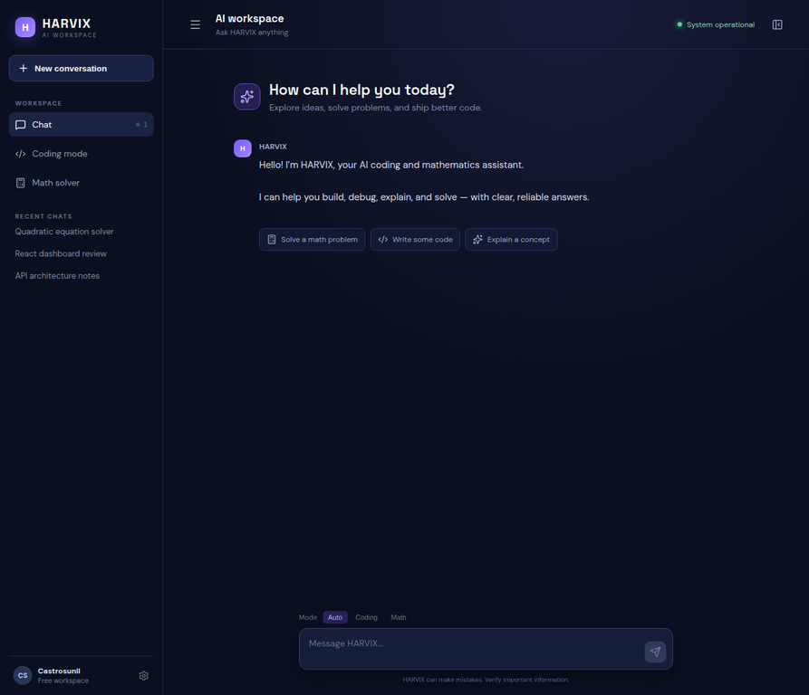

# HARVIX Project Report

## Aim
To design and implement HARVIX, a cloud-ready AI assistant dashboard that supports programming assistance, mathematical problem solving, intent-based routing, and a responsive conversational user experience.

## Procedure
1. Analysed the required capabilities and divided the system into a React frontend, FastAPI backend, routing layer, and symbolic math engine.
2. Implemented a responsive dark-theme dashboard with conversation history, mode selector, new-chat action, suggestion prompts, typing indicator, and copy action.
3. Implemented REST endpoints for health checks, chat routing, and exact mathematics using SymPy.
4. Added an optional OpenAI adapter that reads credentials only from environment variables and keeps a deterministic local fallback for development.
5. Added validation, CORS configuration, Docker files, environment template, GitHub Actions CI, and automated API tests.
6. Built the frontend and executed the backend test suite before committing and pushing the project.

## Screenshot — Dashboard

## Verification
- `pytest -q` — health, math equation, and coding-route API tests.
- `npm run build` — production frontend build.
- `GET /api/health` — service readiness check.

## Result
HARVIX is delivered as a runnable full-stack project with documented local and Docker setup. The GitHub repository contains the complete source and CI workflow.
